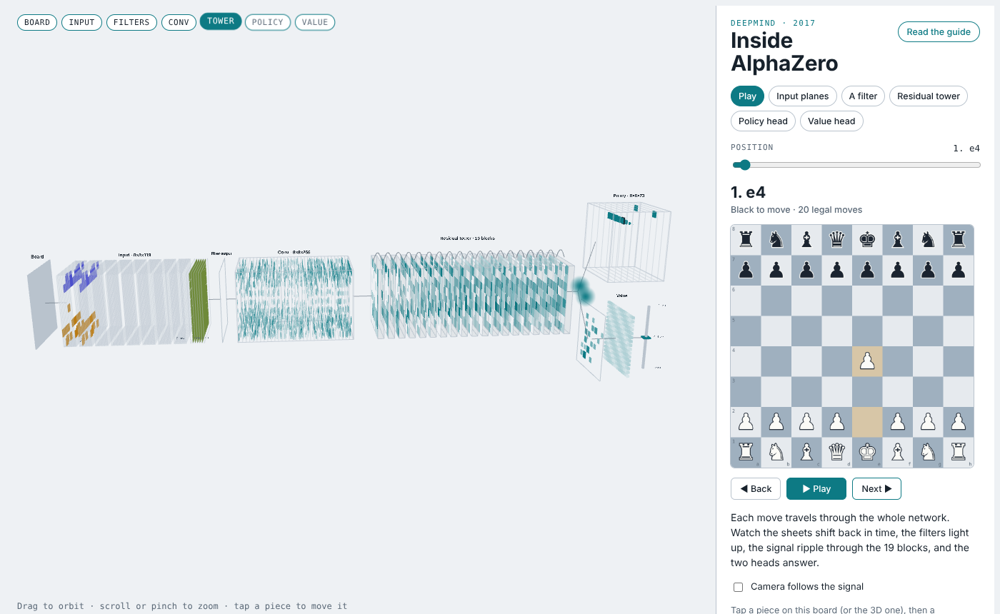
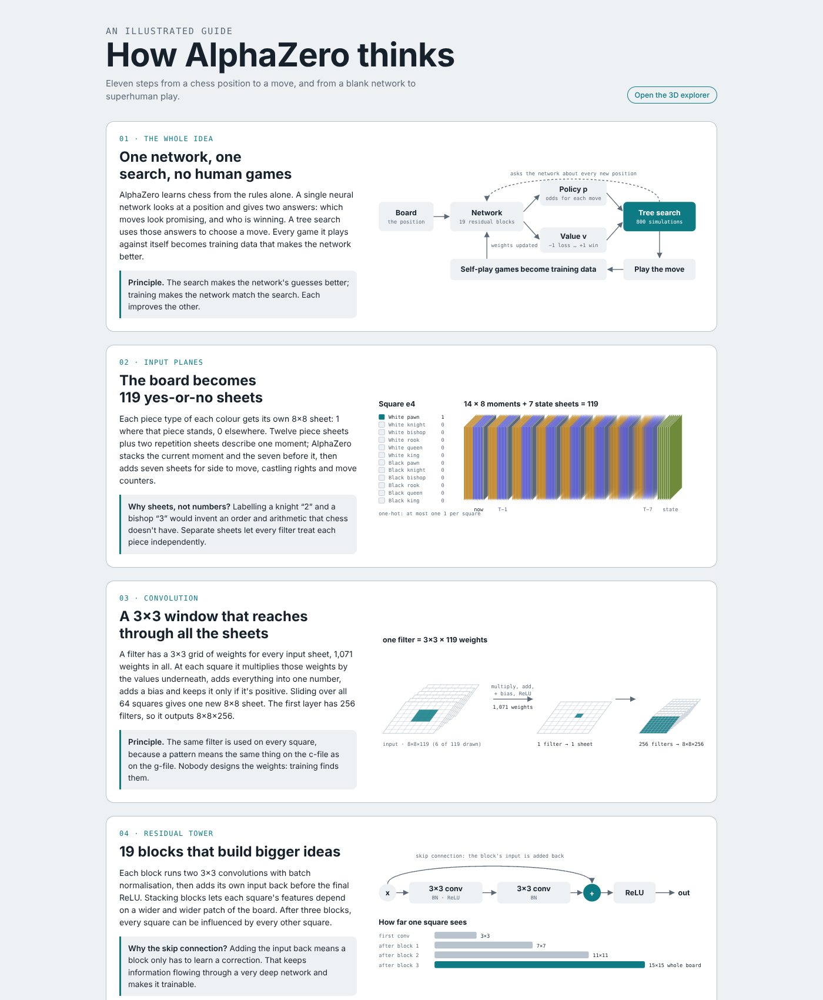

# Inside AlphaZero

An interactive 3D explorer and illustrated guide to the neural network behind **AlphaZero**, DeepMind's self-taught chess engine.

Play a move and watch it travel through the whole network: the input sheets shift back in time, the filters light up, the signal ripples through the 19 residual blocks, and the policy and value heads answer.



**Live demo:** https://shanem73.github.io/inside-alphazero/

---

## What's inside

### 3D explorer (`index.html`)

| Stage | What you can do |
|---|---|
| **Play** | Step through Morphy's *Opera Game* (1858) or play your own moves on the board. Every move triggers an animated pass through the network. |
| **Input planes** | Inspect all 119 input sheets (8×8×119): 12 piece sheets and 2 repetition sheets for each of the last 8 positions, plus 7 game-state sheets. |
| **A filter** | Watch a hand-made 3×3×119 filter ("black pawn attacks white piece") sweep the board, with the arithmetic for every square. |
| **Residual tower** | Browse feature maps through the 19 residual blocks and see how far one square can "see" at each depth. |
| **Policy head** | See how a move maps to one of 4,672 slots (64 squares × 73 move types), and which slots are legal right now. |
| **Value head** | See how the single −1…+1 output is formed and what it means as an expected score. |

### Illustrated guide (`index.html#guide`)

Eleven illustrated sections covering the whole system: input encoding, convolution, residual blocks and receptive fields, how 3×3 filters can detect long-range bishop attacks, the policy and value heads, Monte Carlo tree search, self-play training, real learned filters from an open network, and the match result against Stockfish.



---

## How faithful is it?

- **Architecture:** the layer shapes follow the AlphaZero paper (Silver et al., *Science*, 2018): 8×8×119 input, a 256-filter 3×3 convolution, 19 residual blocks, an 8×8×73 policy head, and a value head with a 1×1 convolution, a 256-unit layer and tanh.
- **Weights:** AlphaZero's trained weights were never released, so the explorer runs these shapes with **random weights**. The animations show how information flows, not what AlphaZero learned. To stay fast in the browser, the residual tower runs 32 channels instead of 256.
- **Value gauge:** because a random network outputs noise, the value gauge is driven by a stand-in (material count squashed with tanh, ±1 at checkmate).
- **Policy slots:** legal moves come from real move generation (chess.js) and are mapped into the 73-plane encoding. The exact order of the 73 planes in this demo is illustrative.
- **Board orientation:** AlphaZero flips the board so the side to move is always at the bottom. The explorer keeps White at the bottom so the sheets are easier to follow.
- **Real filters in the guide** come from [Maia Chess](https://github.com/CSSLab/maia-chess) (`maia-1900`), an open network using the Leela Chess Zero architecture, which follows AlphaZero's design.

---

## Run it locally

It's a single static page with no build step required to view it.

```bash
git clone https://github.com/ShaneM73/inside-alphazero.git
cd inside-alphazero
python3 -m http.server 8000
# open http://localhost:8000
```

Three.js, chess.js and the fonts load from public CDNs, so you need an internet connection.

### Editing

The page is assembled from three source files:

```
src/template.html   page structure and styles
src/app.js          3D scene, network, animation and controls
src/build.py        illustrated guide (SVG figures) + assembly
```

After editing, rebuild `index.html`:

```bash
python3 src/build.py
```

---

## Publishing

The live site is served by GitHub Pages from the `gh-pages` branch. After changing the page, rebuild it, commit to `main`, and update `gh-pages`:

```bash
python3 src/build.py
git commit -am "Update page"
git push origin main
git push origin main:gh-pages
```

---

## Project structure

```
index.html              the built page (explorer + guide)
src/                    sources used to build index.html
docs/screenshots/       images for this README
.nojekyll               serve files as-is on GitHub Pages
```

## Credits and sources

- D. Silver et al., "A general reinforcement learning algorithm that masters chess, shogi, and Go through self-play," *Science* 362 (2018).
- T. McGrath et al., "Acquisition of chess knowledge in AlphaZero," *PNAS* 119 (2022).
- [Maia Chess](https://github.com/CSSLab/maia-chess), source of the real filter weights shown in the guide.
- Built with [three.js](https://threejs.org/) and [chess.js](https://github.com/jhlywa/chess.js).

This is an independent educational project and is not affiliated with DeepMind or Google.

## License

MIT. See [LICENSE](LICENSE).
